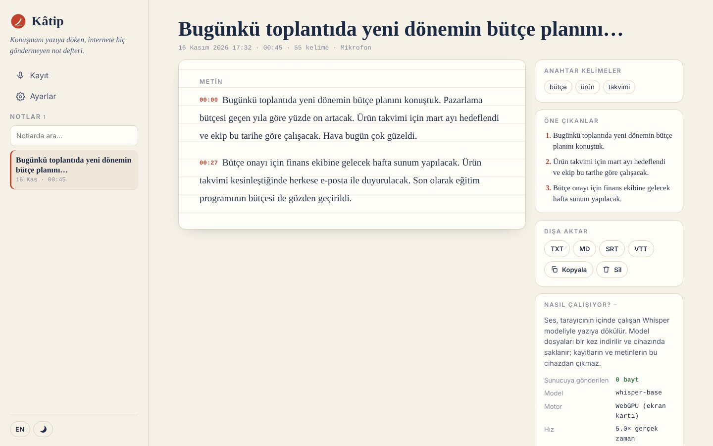
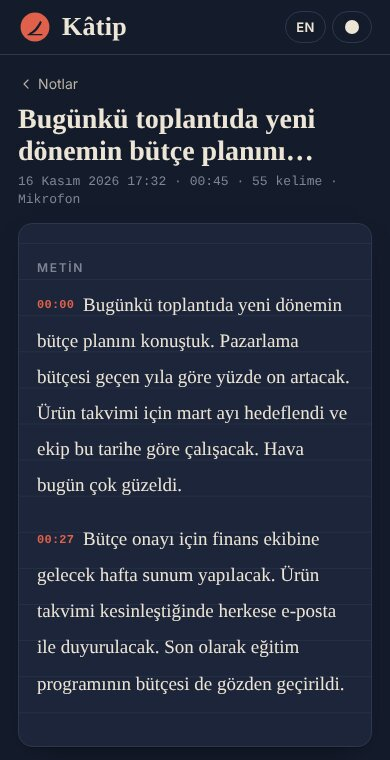

# Kâtip

**Speech-to-text notebook that runs entirely on your device.** Record a meeting or a lecture, or open an audio file; Kâtip writes it down with OpenAI's Whisper model running *inside the browser*. Nothing is uploaded: no server, no account, no API key.

**▶ Live: https://numanak-b221210105.github.io/katip/** (works on phone and desktop, installable as an app)

[](https://github.com/numanak-b221210105/katip/actions/workflows/ci.yml)


<p align="center">
  
  
</p>

## What it does

- **Live transcription while you speak.** Text appears as you talk; grey draft text firms up every ~25 seconds.
- **Open any audio or video file** (mp3, m4a, wav, webm, mp4…) or drag it onto the page.
- **Notes stay on the device** in IndexedDB, with the original audio.
- **Click a sentence to hear it.** The player and the transcript stay in sync.
- **Keywords and highlights** picked from the text (extractive, no extra model).
- **Export** as TXT, Markdown, SRT or VTT subtitles, copy, or share with the phone's share sheet.
- **Search** across every transcript.
- **Turkish and English**, both for speech and for the interface. Light and dark themes.
- **Installable and offline.** After the first visit and the one-time model download, it works without internet.
- **Made for phones.** The screen stays on while recording (Screen Wake Lock), so a locked phone does not cut the recording. On Android, voice messages and audio files can be shared straight to Kâtip from any app (Web Share Target). On iPhone, a one-time hint shows how to add it to the Home Screen.
- **Quiet interface sounds** (synthesized, no audio files) that never play while the microphone is open, so they never end up in a recording. They follow the phone's silent switch and can be turned off.

## How it works

```
 microphone ──► AudioWorklet ──► 16 kHz mono ──┐
                                               ├──► Web Worker: Whisper (ONNX) ──► segments ──► IndexedDB
 audio file ──► decodeAudioData ──► resample ──┘        WebGPU, or WebAssembly as fallback
```

| Piece | Choice | Why |
| --- | --- | --- |
| Model | Whisper tiny / base / small (`onnx-community`), via Transformers.js | Multilingual, good Turkish; small enough for a browser |
| Runtime | ONNX Runtime Web: **WebGPU** when available, otherwise **WASM** | GPU is several times faster; WASM works everywhere |
| Precision | WebGPU: fp32 encoder + 4-bit decoder; WASM: 8-bit | Best speed/accuracy trade-off per backend |
| Threading | The model runs in a Web Worker | The page stays responsive while transcribing |
| Caching | Weights in Cache Storage, app shell in a service worker | Downloaded once, then offline |

**Live mode.** Whisper reads at most 30 seconds at a time. While you record, Kâtip keeps re-reading everything since the last *commit point* as a draft whenever the model is idle. When that window passes ~24 s, it looks for the quietest 200 ms between 18 s and 28 s, cuts there, transcribes that part one last time and commits it. Words are not cut in half, and a slow device never sends more than 28 s at once; this is covered by tests (`tests/live.test.ts`).

**Keywords and highlights** come from plain statistics, not another model. Turkish words are reduced to their first five letters (a well-known, surprisingly strong stemmer for an agglutinative language: *toplantı, toplantıda, toplantının* all match). Sentences are scored by how many recurring topic words they contain.

The note page has a **"How does it work?"** panel showing the model, the backend, the speed (× real time) and the number of bytes sent to a server: **0**.

## Run it yourself

Requires Node 20+.

```bash
git clone https://github.com/numanak-b221210105/katip
cd katip
npm install
npm run dev        # http://localhost:5173
```

Or double-click `start.bat` (Windows) / run `./start.sh` (macOS, Linux).

```bash
npm test           # 20 unit tests: audio, formats, summary, live controller, storage
npm run build      # static site in dist/
```

The build is a static site; any static host works. This repo deploys to GitHub Pages with Actions.

## Honest notes

- **First run downloads the model**: about 40 MB (tiny), 80 MB (base, default) or 250 MB (small). It comes from the Hugging Face hub and is cached by the browser.
- **Speed depends on the device.** With WebGPU on a recent laptop, *base* runs many times faster than real time. On an older phone using WASM, *tiny* is the comfortable choice.
- **Accuracy** is Whisper's: very good on clear speech, weaker with crosstalk, heavy background noise or many proper names.
- **Keywords and highlights are extractive**: they pick existing sentences and words; they do not write a summary.
- **Browser storage can be cleared** by the browser or the user. Export notes you want to keep.
- iOS Safari supports recording and file import; WebGPU availability varies by version, and WASM is used otherwise.

## Project layout

```
src/
  main.ts          UI: record, notes, note, settings (no framework)
  asr.worker.ts    Whisper pipeline in a Web Worker
  asr.ts           worker client, device detection, model cache
  recorder.ts      microphone → 16 kHz blocks + compressed copy for playback
  live.ts          live transcription controller (commit points, quiet cuts)
  audio.ts         decode, resample, WAV, RMS, quiet-cut search
  format.ts        SRT / VTT / TXT / Markdown, paragraphs
  summary.ts       keywords and highlights (TR + EN)
  store.ts         IndexedDB notes, search, titles
  i18n.ts          Turkish / English strings
public/
  sw.js            offline app shell
  manifest.webmanifest
tests/             Vitest
```

---

## Türkçe

**Kâtip**, konuşmayı tamamen cihazında yazıya döken bir not defteri. Toplantıyı ya da dersi kaydet veya bir ses dosyası aç; Whisper modeli *tarayıcının içinde* çalışır ve metni yazar. Hiçbir şey yüklenmez: sunucu yok, hesap yok, API anahtarı yok.

**Canlı:** https://numanak-b221210105.github.io/katip/ (telefonda ve bilgisayarda çalışır, uygulama olarak yüklenebilir)

- Konuşurken **canlı yazıya dökme**; gri taslak metin yaklaşık 25 saniyede bir kesinleşir.
- **Ses/video dosyası açma** ya da sayfaya sürükleyip bırakma.
- Notlar sesle birlikte **cihazda** (IndexedDB) saklanır.
- **Cümleye tıkla, o anı dinle**; oynatıcı ve metin senkron.
- **Anahtar kelimeler ve öne çıkan cümleler** (ek model yok, istatistiksel).
- **TXT, Markdown, SRT, VTT** olarak dışa aktarma, kopyalama, telefonun paylaş menüsü.
- Tüm notlarda **arama**; **Türkçe/İngilizce** konuşma ve arayüz; açık/koyu tema.
- **Yüklenebilir ve çevrimdışı**: ilk açılış ve modelin bir kez indirilmesinden sonra internetsiz çalışır.
- **Telefon için**: kayıt sırasında ekran kapanmaz; Android'de WhatsApp sesli mesajları ve ses dosyaları doğrudan Kâtip'e paylaşılabilir; iPhone'da ana ekrana ekleme ipucu çıkar.

İlk kullanımda model indirilir (varsayılan *base* yaklaşık 80 MB). Hız cihaza bağlıdır: WebGPU olan bir bilgisayarda gerçek zamandan çok daha hızlı, eski bir telefonda *tiny* modeli önerilir. Anahtar kelimeler ve öne çıkanlar metindeki cümleleri seçer, yeni özet yazmaz. Tarayıcı depolaması silinebilir; saklamak istediğin notları dışa aktar.

## License

MIT © Numan AK
